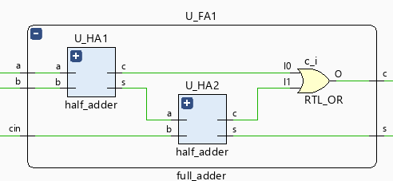
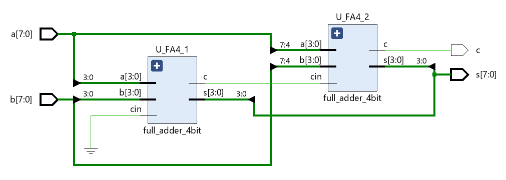

# adder

# 설계 목표
half adder → full adder → 4bit full adder → 8bit full adder 순으로 단계적으로 코드 설계

# half_adder vs full_adder 차이

| 구분 | Half Adder (반가산기) | Full Adder (전가산기) |
|---|---|---|
| 입력 | a, b (2개) | a, b, Cin (3개) |
| 출력 | S (합), C (캐리) | S (합), Cout (캐리 출력) |
| 아랫자리 올림수(Cin) 처리 | 불가 | 가능 |
| 구성 | XOR 1개 + AND 1개 | Half Adder 2개 + OR 1개 |
| 용도 | 최하위 1bit 덧셈 | 다비트 덧셈의 각 자리 (N-bit 확장 가능) |

Half Adder는 아랫자리에서 올라온 캐리를 받을 수 없기 때문에, 여러 비트를 더하려면 캐리 입력(Cin)이 있는 Full Adder가 필요합니다.

# half_adder 진리표

| a | b | S | C |
|:-:|:-:|:-:|:-:|
| 0 | 0 | 0 | 0 |
| 0 | 1 | 1 | 0 |
| 1 | 0 | 1 | 0 |
| 1 | 1 | 0 | 1 |

### 논리식
```
S = a ⊕ b      (a와 b가 다를 때 1)
C = a · b      (a와 b가 모두 1일 때 1)
```
→ XOR 게이트 1개와 AND 게이트 1개로 구성

# full_adder 진리표

| a | b | Cin | S1 (a⊕b) | C1 (a·b) | S2 (S1⊕Cin) | C2 (S1·Cin) | Cout (C1+C2) |
|:-:|:-:|:-:|:-:|:-:|:-:|:-:|:-:|
| 0 | 0 | 0 | 0 | 0 | 0 | 0 | 0 |
| 0 | 0 | 1 | 0 | 0 | 1 | 0 | 0 |
| 0 | 1 | 0 | 1 | 0 | 1 | 0 | 0 |
| 0 | 1 | 1 | 1 | 0 | 0 | 1 | 1 |
| 1 | 0 | 0 | 1 | 0 | 1 | 0 | 0 |
| 1 | 0 | 1 | 1 | 0 | 0 | 1 | 1 |
| 1 | 1 | 0 | 0 | 1 | 0 | 0 | 1 |
| 1 | 1 | 1 | 0 | 1 | 1 | 0 | 1 |

- **S1, C1**: 첫 번째 Half Adder의 출력 (a, b를 더함)
- **S2, C2**: 두 번째 Half Adder의 출력 (S1과 Cin을 더함)
- **S2**가 최종 합이고, **Cout = C1 + C2**가 최종 캐리입니다.

### 합(S) 식 전개
진리표에서 S = 1인 행(minterm)을 모두 더합니다.

```
S = ~Cin·~a·b + ~Cin·a·~b + Cin·~a·~b + Cin·a·b

  = ~Cin·(~a·b + a·~b) + Cin·(~a·~b + a·b)      ← Cin 기준으로 묶기

  = ~Cin·(a ⊕ b) + Cin·~(a ⊕ b)                 ← (~a·b + a·~b) = XOR, (~a·~b + a·b) = XNOR

  = Cin ⊕ (a ⊕ b)                                ← X·~Y + ~X·Y 꼴이므로 XOR
```

### 캐리(Cout) 식 전개
진리표에서 Cout = 1인 행(minterm)을 모두 더합니다.

```
Cout = ~Cin·a·b + Cin·~a·b + Cin·a·~b + Cin·a·b

     = ~Cin·a·b + Cin·(~a·b + a·~b + a·b)       ← Cin 기준으로 묶기

     = ~Cin·a·b + Cin·(a + b)                     ← (~a·b + a·~b + a·b) = a + b

     = a·b·(~Cin + Cin) + Cin·(a ⊕ b)             ← Cin·(a + b) = Cin·a·b + Cin·(a ⊕ b) 로 분해

     = a·b + Cin·(a ⊕ b)                          ← (~Cin + Cin) = 1
```

### 최종 결과: Half Adder 2개 + OR 1개
```
1단계 (Half Adder #1):  S1 = a ⊕ b        C1 = a · b
2단계 (Half Adder #2):  S  = S1 ⊕ Cin     C2 = S1 · Cin
최종 캐리:               Cout = C1 + C2
```
→ Full Adder는 Half Adder 2개를 연결하고 두 캐리를 OR로 합쳐서 만들 수 있습니다.

# schematic
### Half Adder


### Full Adder


### 4-bit Full Adder


### 8-bit Full Adder

