# adder_fnd

Full Adder의 계산 결과를 Basys3 보드의 **FND(7-segment)** 에 표시하는 설계입니다.
4bit 가산기로 FND 표시 원리를 익힌 뒤, 8bit 가산기의 결과를 10진수 4자리로 표시하도록 확장했습니다.

| 버전 | 내용 |
|---|---|
| [4bit](#1-4bit-adder--fnd) | 4bit 합을 16진수(0~F) 한 자리로 표시 |
| [8bit](#2-8bit-adder--fnd) | 8bit 합(0~510)을 10진수 4자리로 표시 |

---

# 1. 4bit adder → FND

## 설계 목표
`full_adder_4` → `BCD 디코더(bin → fnd_font)` → **FND 출력** 순서로 연결해서, 스위치로 입력한 a, b의 덧셈 결과를 보드에서 눈으로 확인합니다.

## 전체 구조 (adder_4_fnd)

```
            ┌───────────────────────────────────────────────┐
 a[3:0] ───►│ ┌─────────────┐  s[3:0]   ┌─────┐  fnd_font[7:0]│
 b[3:0] ───►│ │ full_adder_4│──────────►│ BCD │──────────────►│──► FND 세그먼트 (CA~CG, DP)
 cin    ───►│ └─────────────┘  (binary) └─────┘               │
            │        └─► c (캐리)                             │
            │            fnd_com[3:0] = 4'b1110 ─────────────►│──► FND 자리 선택 (AN3~AN0)
            └───────────────────────────────────────────────┘
```

| 신호 | 비트 수 | 설명 |
|---|:-:|---|
| a, b | 4 | 입력 (0 ~ 15) |
| cin | 1 | 캐리 입력 (GND로 고정하면 0) |
| s | 4 | 덧셈 결과 (binary, 0 ~ 15) |
| c | 1 | 캐리 출력 (0 ~ 1) |
| fnd_font | 8 | 세그먼트 7개 + DP 점등 패턴 |
| fnd_com | 4 | 4개 자리 중 켤 자리 선택 |

## FND(7-segment) 동작 원리

Basys3의 FND는 **4자리 Common Anode** 방식입니다. 각 자리는 세그먼트 7개(a~g)와 소수점(DP)으로 이루어진 LED이고, 전류는 **애노드(p) → 캐소드(n)** 방향으로 흐릅니다 (pn 접합 발광 다이오드).

- **Common Anode**: 한 자리의 LED 8개가 애노드를 공통으로 묶고 있습니다.
- **자리 선택 (AN3 ~ AN0)**: 애노드 앞의 트랜지스터를 거치므로 **0(Low)일 때 해당 자리가 켜집니다.**
- **세그먼트 점등 (CA ~ CG, DP)**: 캐소드 쪽이 **0(Low)일 때 해당 LED가 켜집니다.**
- 즉 **자리 선택과 세그먼트 모두 Active Low** 입니다. (GND: 0 = Low, VCC: 1 = High)

### 자리 선택 fnd_com
| fnd_com | 켜지는 자리 |
|:-:|---|
| `4'b1110` | AN0 (가장 오른쪽 자리) |
| `4'b1101` | AN1 |
| `4'b1011` | AN2 |
| `4'b0111` | AN3 (가장 왼쪽 자리) |

4bit 버전에서는 오른쪽 한 자리에만 결과를 표시하므로 `fnd_com = 4'b1110`으로 고정(assign)했습니다.

## BCD 디코더 (bin → fnd_font)

4bit 이진수(`bin`)를 받아 FND에 표시할 8bit 패턴(`fnd_font`)으로 바꿉니다.
입력이 0 ~ 15이므로 0~9는 숫자, 10~15는 A~F로 표시합니다.

`fnd_font` 비트 순서: **`{DP, G, F, E, D, C, B, A}`** (0이면 점등)

### BCD truth table

| bin (10진) | bin (2진) | DP | G | F | E | D | C | B | A | fnd_font (2진) | fnd_font (16진) | 표시 |
|:-:|:-:|:-:|:-:|:-:|:-:|:-:|:-:|:-:|:-:|:-:|:-:|:-:|
| 0  | 0000 | 1 | 1 | 0 | 0 | 0 | 0 | 0 | 0 | 1100_0000 | C0 | 0 |
| 1  | 0001 | 1 | 1 | 1 | 1 | 1 | 0 | 0 | 1 | 1111_1001 | F9 | 1 |
| 2  | 0010 | 1 | 0 | 1 | 0 | 0 | 1 | 0 | 0 | 1010_0100 | A4 | 2 |
| 3  | 0011 | 1 | 0 | 1 | 1 | 0 | 0 | 0 | 0 | 1011_0000 | B0 | 3 |
| 4  | 0100 | 1 | 0 | 0 | 1 | 1 | 0 | 0 | 1 | 1001_1001 | 99 | 4 |
| 5  | 0101 | 1 | 0 | 0 | 1 | 0 | 0 | 1 | 0 | 1001_0010 | 92 | 5 |
| 6  | 0110 | 1 | 0 | 0 | 0 | 0 | 0 | 1 | 0 | 1000_0010 | 82 | 6 |
| 7  | 0111 | 1 | 1 | 1 | 1 | 1 | 0 | 0 | 0 | 1111_1000 | F8 | 7 |
| 8  | 1000 | 1 | 0 | 0 | 0 | 0 | 0 | 0 | 0 | 1000_0000 | 80 | 8 |
| 9  | 1001 | 1 | 0 | 0 | 1 | 0 | 0 | 0 | 0 | 1001_0000 | 90 | 9 |
| 10 | 1010 | 1 | 0 | 0 | 0 | 1 | 0 | 0 | 0 | 1000_1000 | 88 | A |
| 11 | 1011 | 1 | 0 | 0 | 0 | 0 | 0 | 1 | 1 | 1000_0011 | 83 | b |
| 12 | 1100 | 1 | 1 | 0 | 0 | 0 | 1 | 1 | 0 | 1100_0110 | C6 | C |
| 13 | 1101 | 1 | 0 | 1 | 0 | 0 | 0 | 0 | 1 | 1010_0001 | A1 | d |
| 14 | 1110 | 1 | 0 | 0 | 0 | 0 | 1 | 1 | 0 | 1000_0110 | 86 | E |
| 15 | 1111 | 1 | 0 | 0 | 0 | 1 | 1 | 1 | 0 | 1000_1110 | 8E | F |

DP(소수점)는 항상 1(소등)입니다.

## 코드 설명 (BCD 디코더)

`always @(*)` 조합회로 블록에서 4bit 입력 `bin`을 `case`문으로 비교해, 해당 숫자를 FND에 표시하는 8bit 세그먼트 패턴 `fnd_font`로 변환합니다.

- Basys3의 FND는 Common Anode(Active Low)라서 **0이 점등, 1이 소등**입니다.
- 예: `4'd0` → `8'hC0` (`1100_0000`) : a~f 점등, g·dp 소등 → "0" 표시
- 정의되지 않은 입력은 `default`에서 `8'hFF`(전체 소등)로 처리합니다.

### schematic - 4bit
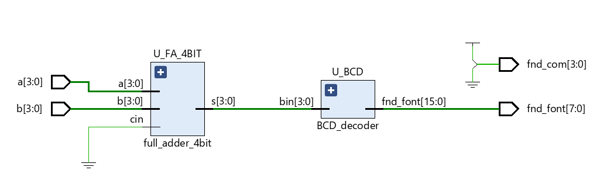

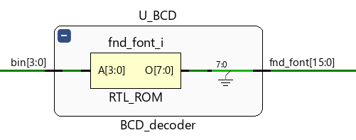

**시뮬레이션 1**
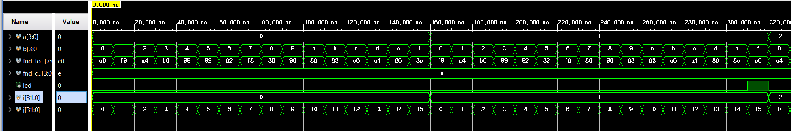

**시뮬레이션 2**
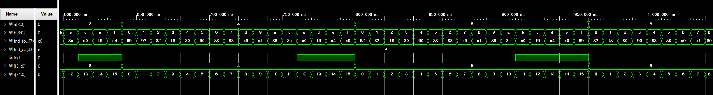

**시뮬레이션 3**
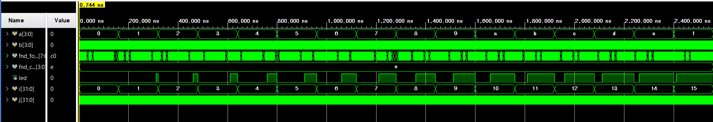 


## 보드 동작 확인 (Basys3) - 4bit

스위치로 a, b(4bit)를 입력하고, 합 `s`가 FND 오른쪽 첫째 자리(AN0)에 표시되는 것을 확인했습니다.

| # | a | b | cin | 합 (10진) | FND 표시 |
|:-:|:-:|:-:|:-:|:-:|:-:|
| 1 | (입력값) | (입력값) | 0 | 2 | `2` |
| 2 | (입력값) | (입력값) | 0 | 6 | `6` |
| 3 | (입력값) | (입력값) | 0 | 5 | `5` |
| 4 | (입력값) | (입력값) | 0 | 14 | `E` |

- 합이 10 이상(14)이면 BCD 디코더가 **A~F(16진)** 로 표시합니다. (14 → `E`)
- 오른쪽 첫째 자리만 켜지는 것은 `fnd_com = 4'b1110` 고정 때문입니다.

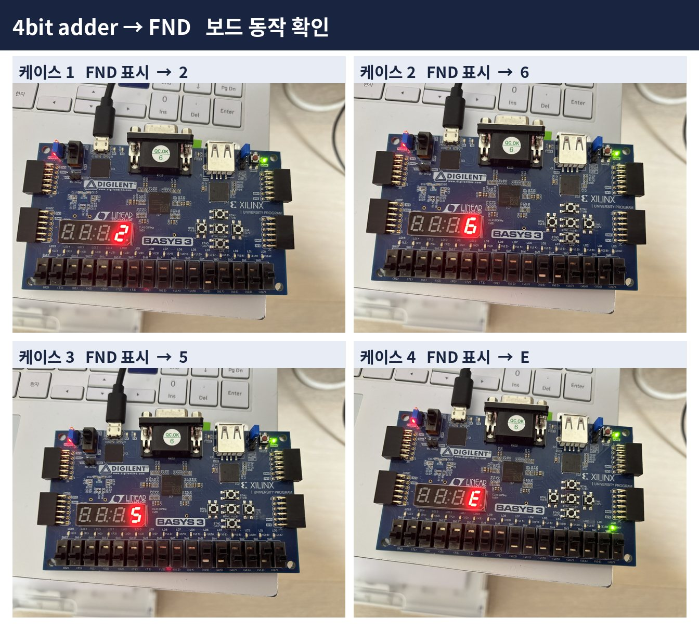


# 2. 8bit adder → FND

## 설계 목표
8bit 가산기의 결과를 **10진수 4자리**로 FND에 표시합니다.
4bit 버전은 결과를 16진수 한 자리(0~F)로만 보여줬지만, 8bit 덧셈은 결과가 최대 **255 + 255 = 510**까지 나오므로 1·10·100·1000의 자리로 나눠서 표시해야 합니다.

| 항목 | 4bit 버전 | 8bit 버전 |
|---|---|---|
| 입력 a, b | 4bit (0~15) | 8bit (0~255) |
| 결과 범위 | 0 ~ 15 (+캐리) | 0 ~ 510 (9bit) |
| 표시 방식 | 16진수 한 자리 | 10진수 4자리 |
| 사용 자리 | 오른쪽 1자리 (`fnd_com` 고정) | 4자리 모두 (`fnd_com` 선택) |
| 자리 선택 | 없음 (assign 고정) | 버튼 2개 (`sel`) |

## 설계 아이디어

FND는 한 번에 한 자리씩 보여주기 때문에, **어떤 자리를 볼지 고르는 신호(`sel`)** 가 핵심입니다.

1. 4bit 가산기 2개를 이어서 8bit 덧셈을 만든다. (결과 `{C, S[7:0]}` = 9bit, 0~510)
2. 9bit 결과를 **digit_splitter**로 1, 10, 100, 1000의 자리 숫자 4개(각 4bit)로 나눈다.
3. 4개 중 하나를 **MUX 4x1** 로 고른다. (4가지 선택 → `sel`은 **2bit**면 충분)
4. 고른 숫자를 **BCD 디코더**로 FND 세그먼트 패턴(`fnd_font`)으로 바꾼다.
5. 같은 `sel`을 **디코더 2x4** 에 넣어 켤 자리(`fnd_com`)를 만든다. (2bit 입력 → 4bit 출력)
6. `sel`은 **보드 버튼 `{BtnL, BtnR}`** 에 연결한다. (누르면 1, 떼면 0)

→ 버튼을 누르는 조합에 따라 **보여줄 숫자(MUX)** 와 **켜질 자리(디코더)** 가 함께 바뀝니다.

## 전체 구조 (adder_fnd)

```
 a[7:0] ─┬ a[3:0] ┐   ┌────────────┐
 b[7:0] ─┤ b[3:0] ├──►│ FA4_2      │ S[3:0] ─────────┐
         │        │   │ (Cin = 0)  │                  │
         │        │   └─────┬──────┘                  │
         │        │         │ C                       │  sum[8:0]
         │ a[7:4] ┐   ┌─────▼──────┐                  ├──────────────┐
         └ b[7:4] ├──►│ FA4_1      │ S[7:4] ─────────┤              │
                  │   │ (Cin = C)  │ C (최종 캐리) ───┘              │
                  │   └────────────┘                                 ▼
                  │                                         ┌────────────────┐
                  │                                         │ digit_splitter │
                  │                                         └─┬──┬──┬──┬─────┘
                  │                                      ds1  │  │  │  │ ds1000
                  │                                     ds10──┘  │  │  └──┐ (각 4bit)
                  │                                     ds100────┘  │     │
                  │                                   ┌─────────────▼─────▼───┐
 {BtnL, BtnR} ──► sel[1:0] ─────────────────────────► │ MUX 4x1               │
                  │                                   └──────────┬────────────┘
                  │                                              │ bin[3:0]
                  │                                         ┌────▼─────┐
                  │                                         │   BCD    │──► fnd_font[7:0]
                  │                                         └──────────┘
                  └─────────────────────────────────► ┌────────────────┐
                                                      │ decoder 2x4    │──► fnd_com[3:0]
                                                      └────────────────┘
```

## 모듈 설명

### 8bit 가산기 (FA4 × 2)
- **FA4_2**: 하위 4bit(`a[3:0] + b[3:0]`)를 더함. `Cin = 0` (GND)
- **FA4_1**: 상위 4bit(`a[7:4] + b[7:4]`)를 더함. `Cin` = FA4_2의 캐리 `C`
- 최종 결과는 `{C, S[7:0]}` 9bit (0 ~ 510)

### digit_splitter
9bit 결과(`bin`)를 10진수 각 자리로 분리해 4개의 출력(각 4bit)으로 내보냅니다.

| 출력 | 의미 | 510일 때 |
|---|---|:-:|
| `ds1` | 1의 자리 | 0 |
| `ds10` | 10의 자리 | 1 |
| `ds100` | 100의 자리 | 5 |
| `ds1000` | 1000의 자리 | 0 |

### MUX 4x1 + sel
`sel`(2bit)로 `ds1 / ds10 / ds100 / ds1000` 중 하나를 선택해 BCD 디코더의 입력(`bin`)으로 보냅니다.

### 디코더 2x4 → fnd_com
같은 `sel`을 4bit `fnd_com`으로 바꿔서 해당 자리만 켭니다. (Active Low)

| sel | 선택되는 값 | fnd_com | 켜지는 자리 |
|:-:|:-:|:-:|---|
| `00` | ds1 (1의 자리) | `1110` | 맨 오른쪽 (AN0) |
| `01` | ds10 (10의 자리) | `1101` | 오른쪽 2번째 (AN1) |
| `10` | ds100 (100의 자리) | `1011` | 왼쪽 2번째 (AN2) |
| `11` | ds1000 (1000의 자리) | `0111` | 맨 왼쪽 (AN3) |

### 버튼 입력
- `{BtnL, BtnR}` 2개를 `sel[1:0]`에 연결합니다.
- 푸시 버튼은 **누르면 1, 떼면 0** 입니다. (버튼 한쪽이 VCC에 연결)

### BCD 디코더
4bit 입력을 FND 세그먼트 패턴으로 바꿉니다. (4bit 버전과 동일, 위 truth table 참고)

## 동작 예시 (255 + 255 = 510)
1. `a = 255`, `b = 255` → FA4_2에서 `15 + 15 = 30`(S=`1110`, C=1), FA4_1에서 `15 + 15 + 1 = 31`(S=`1111`, C=1)
2. `sum = {1, 1111_1110}` = 510
3. digit_splitter: `ds1 = 0`, `ds10 = 1`, `ds100 = 5`, `ds1000 = 0`
4. 버튼을 바꿔 가며 `sel = 00 → 01 → 10 → 11`로 선택하면 FND에 **0 → 1 → 5 → 0** 이 차례로 표시됩니다.


## 스케메틱


## 보드 동작 확인 (Basys3)

스위치로 a, b를 입력하고 FND에 표시된 결과를 사진으로 확인했습니다. 버튼으로 표시할 자리를 바꿔 가며 **1의 자리 → 10의 자리 → 100의 자리 → 1000의 자리** 순서로 기록했습니다.

### 테스트 결과 요약

| # | 연산 | a (2진) | b (2진) | 기대값 | 1의 자리 | 10의 자리 | 100의 자리 | 1000의 자리 | 결과 |
|:-:|:-:|:-:|:-:|:-:|:-:|:-:|:-:|:-:|:-:|
| 1 | 0 + 0 | `00000000` | `00000000` | 0 | 0 | 0 | 0 | 0 | ✅ |
| 2 | 9 + 1 | `00001001` | `00000001` | 10 | 0 | 1 | 0 | 0 | ✅ |
| 3 | 99 + 1 | `01100011` | `00000001` | 100 | 0 | 0 | 1 | 0 | ✅ |
| 4 | 128 + 128 | `10000000` | `10000000` | 256 | 6 | 5 | 2 | 0 | ✅ |
| 5 | 255 + 255 | `11111111` | `11111111` | 510 | 0 | 1 | 5 | 0 | ✅ |

- **케이스 2·3**: 자리올림(9 + 1 → 10, 99 + 1 → 100)
- **케이스 4**: 8bit 최상위 비트끼리의 덧셈 (128 + 128 → 9bit 결과 256)
- **케이스 5**: 최댓값 (255 + 255 = 510)


## 보드 동작 확인 (Basys3) - 8bit

#### 1. 0 + 0 = 0
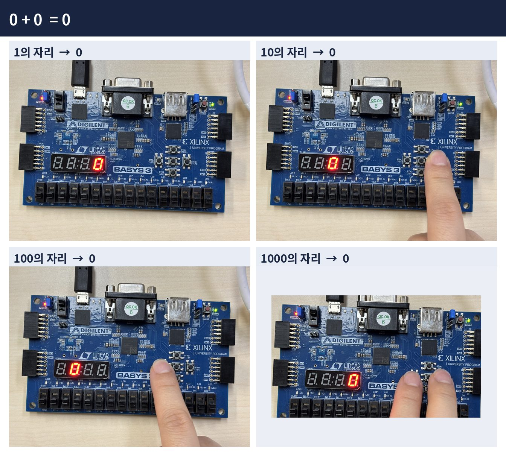

#### 2. 9 + 1 = 10
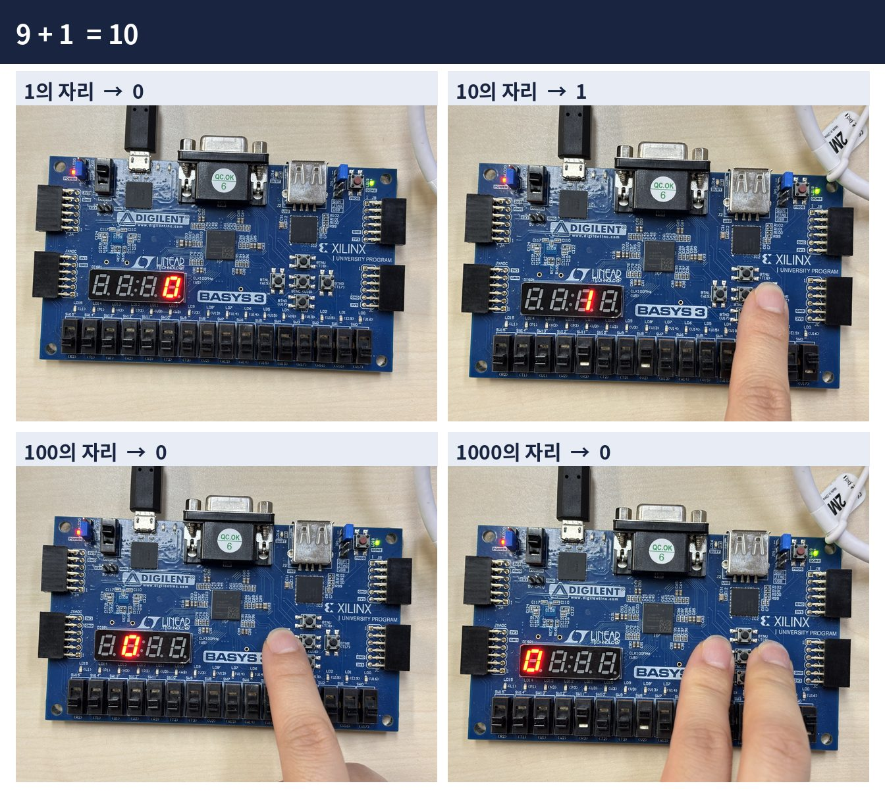

#### 3. 99 + 1 = 100
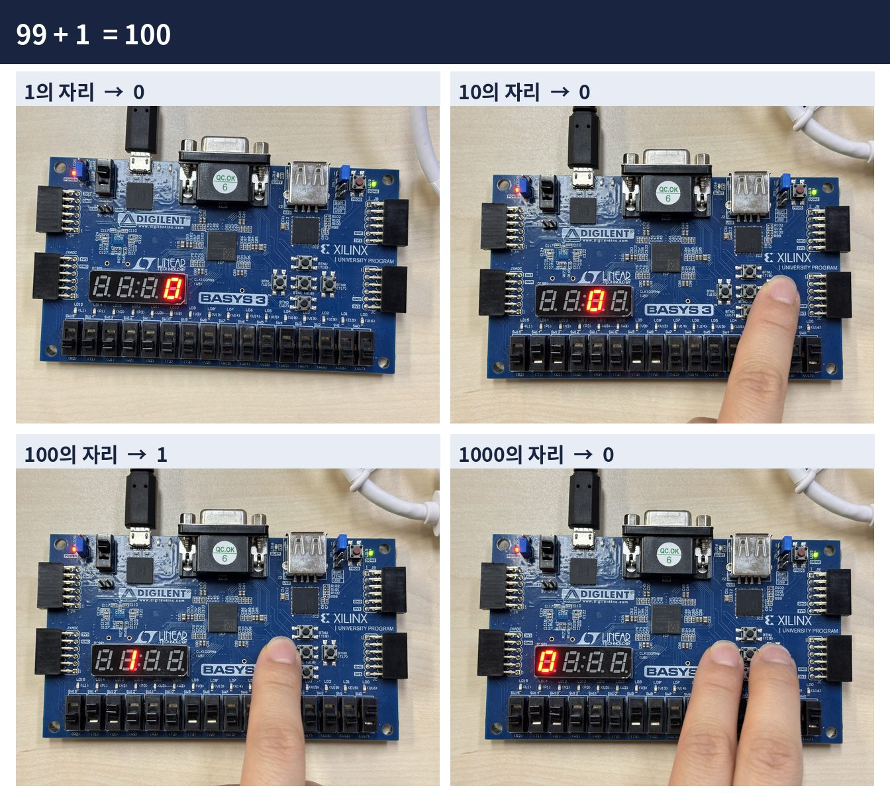

#### 4. 128 + 128 = 256
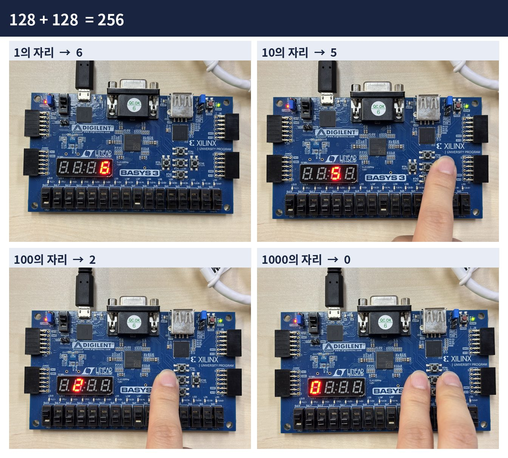

#### 5. 255 + 255 = 510
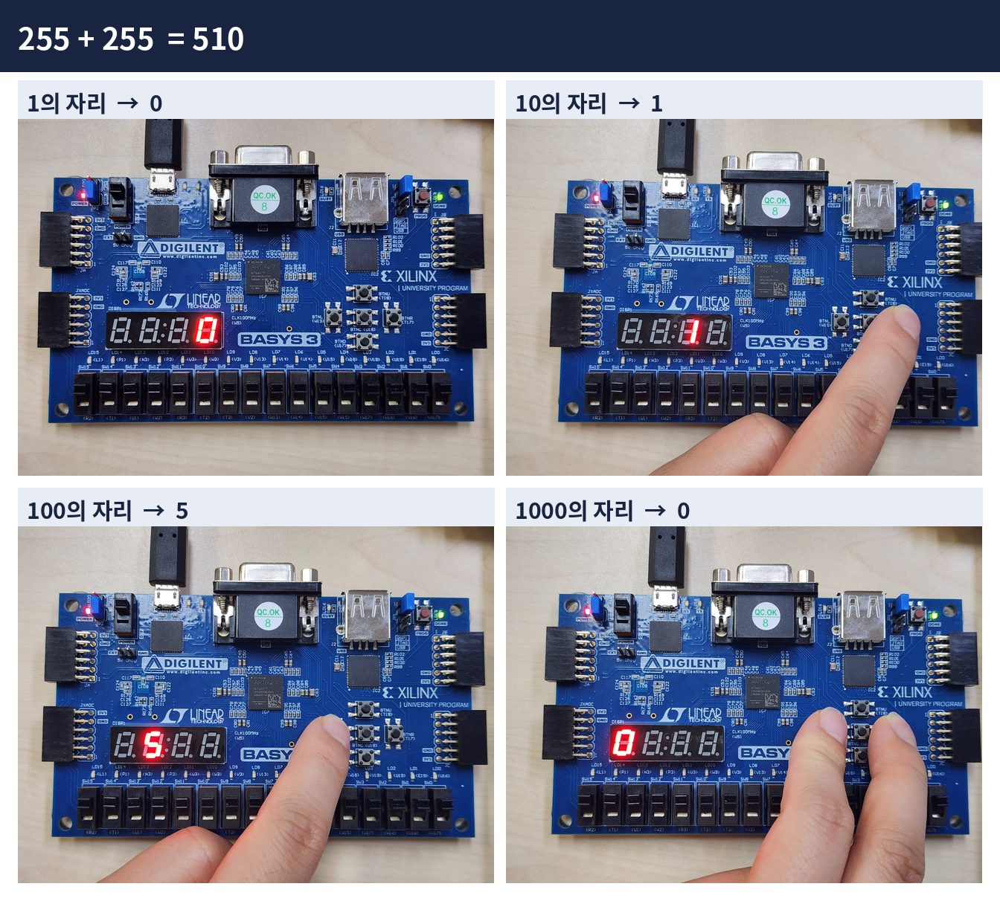


